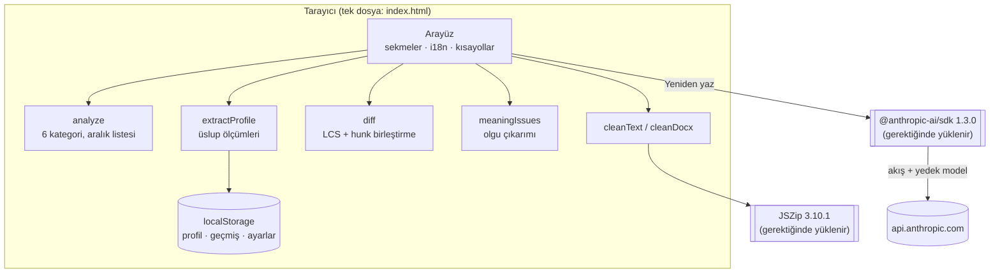

# Mimari ve tasarım kararları

Bu belge Doğal Kalem'in nasıl kurulduğunu ve neden böyle kurulduğunu açıklar.

## Genel bakış

## Kararlar

### 1. Tek dosya, derleme adımı yok
Hedef kullanıcı bir öğretmen ya da proje yazarı. Dosyayı indirip çift tıklamak yetmeli. Bu yüzden derleyici (bundler), framework ya da `node_modules` gerektiren bir çalışma zamanı yok. Kod `<script type="module">` içinde, numaralı bölümlere ayrılmış durumda. Her bölüm başında ne yaptığı ve neden öyle yaptığı açıklanıyor. Bedeli şu: dosya uzun (yaklaşık 1650 satır, gzip ile 41 KB). Bunu bölüm başlıkları ve `window.DK` test yüzeyiyle telafi ediyoruz.

### 2. Analiz yerelde ve deterministik
Analiz bir dil modeline değil, açıklanabilir kurallara dayanıyor:
- Her bulgu bir `{start, end, cat, tip}` aralığı. Kullanıcı neyin neden işaretlendiğini görebiliyor.
- Sonuç ağ olmadan, anında ve her seferinde aynı çıkıyor. Bu, testlerde kesin değerler kullanmayı mümkün kılıyor.
- Kategori puanları yoğunluk temelli (100 kelimedeki eşleşme), yani metin uzunluğundan bağımsız.
- Genel skor `0.8 × ağırlıklı ortalama + 0.2 × en kötü kategori`. Tek ama güçlü bir iz (örneğin gizli bir U+200B) ortalamada kaybolmasın diye.

### 3. Türkçe öncelikli metin işleme
- **İ/ı sorunu:** `/i` bayrağı Türkçe'de yanlış çalışır (`AYRICA`.toLowerCase() → `ayrica`). `phraseRe()` her i-benzeri harfi `[iıİI]` sınıfına çeviriyor ve konum kaydırmadan eşleşiyor.
- **Ekler:** `kapsamlı~` biçimindeki ifadeler `kapsamlıdır`, `kapsamlı` gibi çekimli halleri yakalıyor.
- **Kelime sınırları:** JavaScript'teki `\b` yalnızca ASCII harfleri tanıdığı için `(?<![\p{L}\p{N}])` kullanılıyor.
- **Cümle bölme:** Konumlar korunuyor; kısaltmalar (`Dr.`, `vb.`, `e.g.`) ve ondalık sayılar (`3.5`) cümleyi bölmüyor.

### 4. Vurgulamada tarama çizgisi (sweep line)
Çakışan aralıklar (bir klişe, aynı zamanda tekdüze bir cümlenin içinde olabilir) tüm sınır noktalarından parçalara bölünüyor. Her parça, etkin kategorilerin birleşik sınıflarıyla çiziliyor. Etkin küme sıralı bir tarama ile artımlı güncellendiği için 20.000 kelimede analiz ve çizim yaklaşık 0,25 saniye sürüyor.

### 5. Diff: kelime düzeyinde LCS ve "hunk"lar
- Ortak baş ve son kırpılıyor, ardından `Uint16Array` üzerinde LCS hesaplanıyor.
- Çok büyük girdilerde bellek sınırı aşılmasın diye cümle düzeyine düşülüyor.
- Ardışık silme ve eklemeler, aradaki tek boşlukla birlikte tek bir değişiklik ("hunk") olarak toplanıyor. Kullanıcı kelime kelime değil, anlamlı birimler halinde kabul ya da ret veriyor.
- Sonuç metin her zaman `parts` dizisinden türetiliyor; durum tek bir yerde tutuluyor.

### 6. Anlamı iki katmanda koruma
1. **İstem kuralları:** Olgular, sayılar, alıntılar ve kaynaklar korunur; uydurma yasak, bunun yerine yer tutucu kullanılır.
2. **Yerel olgu karşılaştırması (her zaman çalışır):** Sayılar, alıntılar, URL/e-posta, kaynak gösterimleri ve özel adlar iki metinde karşılaştırılıyor. Türkçe ekler kesme işaretinden ayrılıyor (`Ankara'da` → `Ankara`).
3. **İsteğe bağlı model denetimi:** Ayrı bir istekle yalnızca bilgi kaybı, değişikliği ya da eklemesi JSON olarak raporlanıyor.

### 7. Claude entegrasyonu
- Resmî `@anthropic-ai/sdk` paketi sabit sürümle, yalnızca ilk "Yeniden yaz" tıklamasında dinamik `import()` ile yükleniyor. Analiz bu yüzden çevrimdışı kalıyor.
- Akış (streaming) kullanılıyor: çıktı canlı görünüyor, uzun metinlerde HTTP zaman aşımı olmuyor. `Esc` ile iptal edilebiliyor.
- Derinlik `output_config.effort` ile ayarlanıyor: hafif ve orta yoğunlukta `medium`, baştan yazımda `high`.
- Opus 5.5 ve Sonnet 5.5'te sunucu tarafı yedek model (`fallbacks: "default"`) açık. Bir güvenlik sınıflandırıcısı isteği reddederse yanıt yine de tamamlanıyor. `stop_reason: "refusal"` ayrıca ele alınıyor.
- Hatalar SDK'nın hata sınıflarıyla en özelden en genele eşleniyor (401, 403, 404, 429, 400, bağlantı hatası).
- İstem yapısı XML etiketleriyle bölümlere ayrılıyor: görev, ölçülmüş üslup profili, ses örnekleri, orijinalin analizi, metin. Böylece model ölçülen sayısal hedefleri (cümle uzunluğu ortalaması ve değişimi gibi) doğrudan görüyor.

### 8. `.docx` temizliği
Belge bir ZIP + XML paketi olarak açılıyor:
- `core.xml` ve `app.xml` boş şablonlarla değiştiriliyor.
- `custom.xml`, `people.xml` ve küçük resimler, ilişki (`.rels`) ve içerik türü kayıtlarıyla birlikte siliniyor.
- Tüm `word/*.xml` parçalarından `w:rsid*`, `w:author` ve `w:date` kaldırılıyor.
- İzlenen değişiklikler kabul ediliyor: `w:ins` açılıyor, `w:del` ve `w:moveFrom` siliniyor, `*Change` kayıtları kaldırılıyor.
- ZIP içindeki dosya tarihleri de sabitleniyor.

### 9. Gizlilik ve güvenlik
- **Sunucu yok.** Tüm durum `localStorage`'da; her erişim `try/catch` ile sarılı (gizli pencerede de çalışır).
- **Ağ trafiği:** Yalnızca açık kullanıcı eylemiyle, yalnızca `api.anthropic.com` adresine gidiyor. Service worker bu adresi asla önbelleğe almıyor.
- **HTML kaçışı:** Tüm kullanıcı ve model metni `esc()` ile kaçırılıyor; `innerHTML` yalnızca kaçırılmış içerikle kullanılıyor.
- **Sınırlama:** API anahtarı tarayıcıda durduğu için uygulama kişisel cihazlar için tasarlandı (bkz. [SECURITY.md](SECURITY.md)).

### 10. Test stratejisi
- Testler gerçek Chromium'da uçtan uca çalışıyor (`node:test` + Playwright).
- Anthropic API'si SSE formatında, CDN de yerel paketlerle taklit ediliyor. Testler ağ ve anahtar olmadan, deterministik çalışıyor.
- Erişilebilirlik açık ve koyu temada, tüm ekranlarda axe-core ile WCAG 2.1 AA kurallarına göre denetleniyor.
- Performans eşikleri de test kapsamında.
