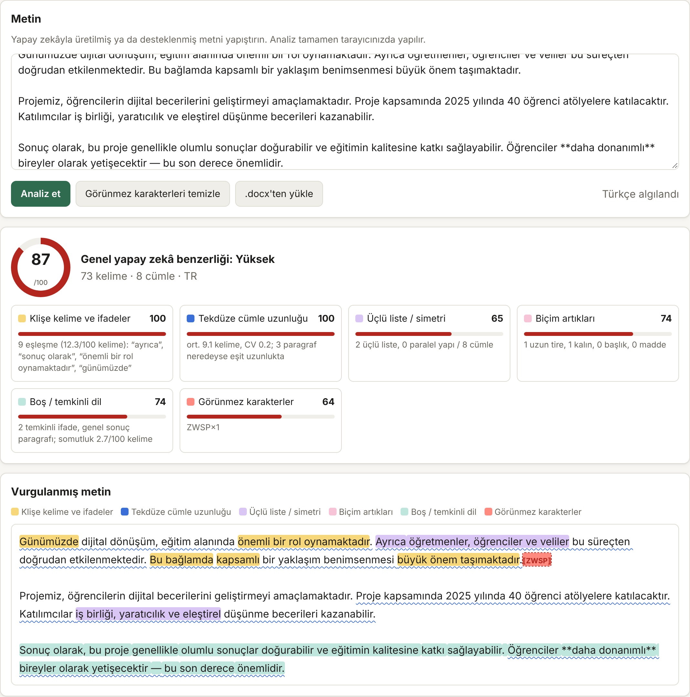
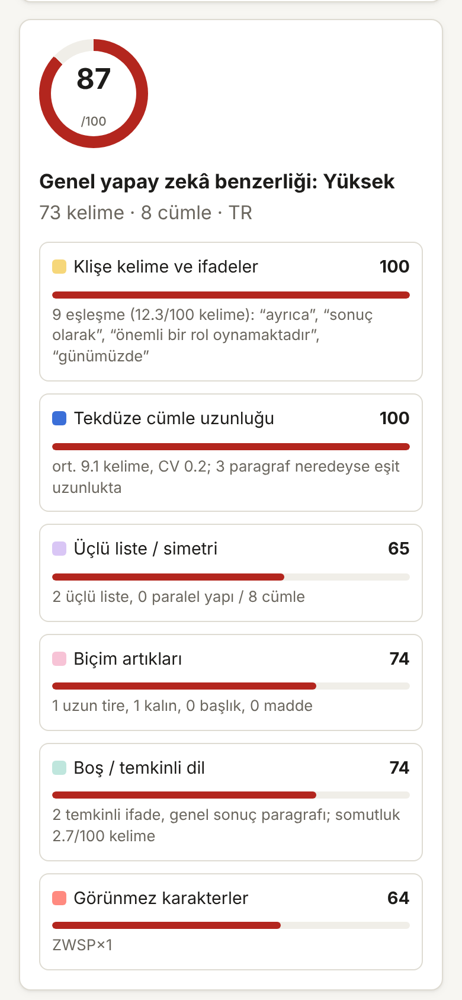
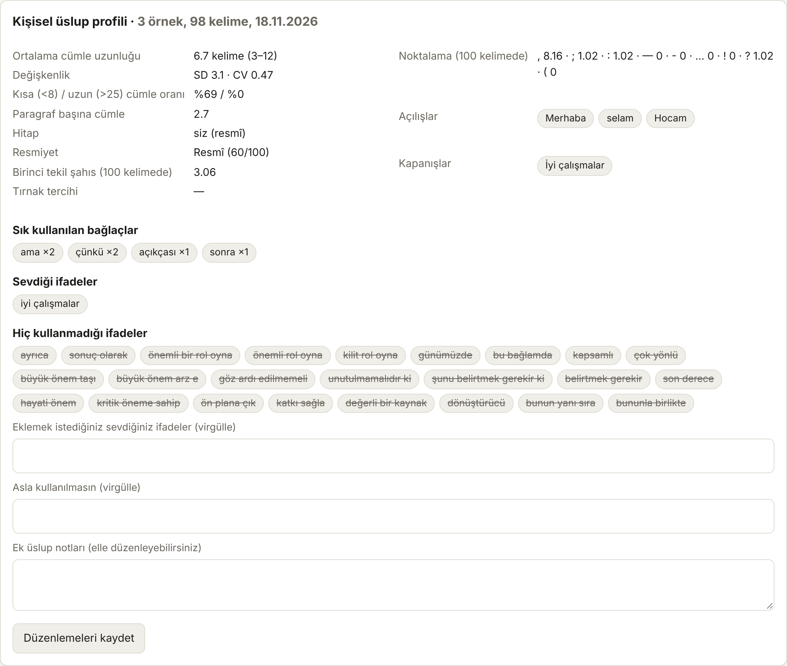
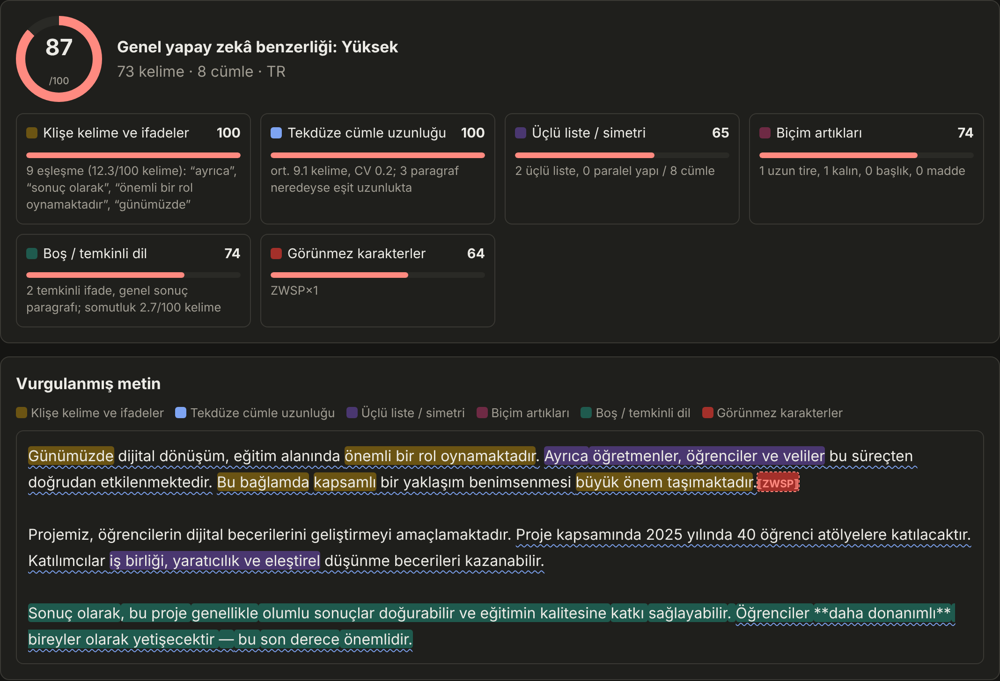

<div align="center">

# ✒️ Doğal Kalem

**Yapay zekâ izlerini bulur, metni sizin sesinizle yeniden yazar.**

Türkçe ve İngilizce metinleri anlamı bozmadan, gerçek bir insanın, özellikle *sizin* yazdığınız gibi okunur hâle getiren tek dosyalık web uygulaması.

[](https://github.com/ozgeozdemirkuvvet/humanizer/actions/workflows/ci.yml)


[**Canlı demo**](https://ozgeozdemirkuvvet.github.io/humanizer/) · [Özellikler](#özellikler) · [Nasıl çalışır](#nasıl-çalışır) · [Geliştirme](#geliştirme) · [English](#english)



</div>

---

## Özellikler

| | |
|---|---|
| 🧬 **Kişisel üslup profili** | Kendi yazdığınız 3–5 metinden cümle uzunluğu ve ritmini, bağlaçlarınızı, hitap biçiminizi, resmiyet düzeyinizi, noktalama alışkanlıklarınızı, sevdiğiniz ve hiç kullanmadığınız ifadeleri çıkarır. |
| 🔍 **Yapay zekâ izi analizi** | Altı kategoride 0–100 puan verir ve bulguları metin üzerinde renkli vurgular. Analiz tamamen çevrimdışı çalışır. |
| ✍️ **Yeniden yazma motoru** | Claude ile, profilinize göre yazar. 5 ton (Resmî/MEB, Akademik, Erasmus+/eTwinning, Samimi e-posta, Öğrenci) ve 3 yoğunluk seçeneği vardır. Bilgi uydurmaz; eksik ayrıntı için `[buraya kendi örneğini ekle]` gibi yer tutucu bırakır. |
| ⚖️ **Karşılaştırma ve kontrol** | Kelime düzeyinde diff gösterir. Her değişikliği tek tek kabul ya da reddedebilirsiniz. Skorun önce/sonra değişimini ve anlam kontrolünü (kaybolan sayı, alıntı, ad, kaynak) gösterir. |
| 🧹 **Temizlik araçları** | Görünmez karakterleri ve markdown artıklarını tek tıkla temizler. `.docx` dosyalarından yazar, uygulama, rsid ve izlenen değişiklik bilgilerini siler. |
| 📱 **Sade arayüz** | Mobil uyumludur; açık/koyu tema ve TR/EN arayüz sunar. Kopyala, `.txt` ve `.docx` indirme düğmeleri vardır; son 10 metni geçmişte tutar. |

## Ekran görüntüleri

<table>
  <tr>
    <td width="62%"></td>
    <td></td>
  </tr>
  <tr>
    <td></td>
    <td></td>
  </tr>
</table>

## Hızlı başlangıç

**Kurulum gerekmez.** [Canlı demoyu](https://ozgeozdemirkuvvet.github.io/humanizer/) açın ya da `index.html` dosyasını indirip tarayıcıda çift tıklayın.

1. **Üslup profili** sekmesine kendi yazdığınız 3–5 metni yapıştırıp *Profili çıkar ve kaydet* düğmesine basın.
2. **Analiz** sekmesine metni yapıştırıp *Analiz et* düğmesine basın.
3. **Ayarlar**'a [Anthropic API anahtarınızı](https://console.anthropic.com/) girin, ardından **Yeniden yaz** sekmesinde ton ve yoğunluğu seçin.
4. **Karşılaştır** sekmesinde değişiklikleri gözden geçirin, sonra kopyalayın ya da `.docx` olarak indirin.

## Nasıl çalışır


### Analiz kategorileri

| Kategori | Neye bakar | Ağırlık |
|---|---|---|
| Klişe kelime ve ifadeler | *Ayrıca, Sonuç olarak, önemli bir rol oynamaktadır, günümüzde, bu bağlamda…* / *delve, tapestry, crucial, pivotal, furthermore, seamless, robust…* (TR'de ekli biçimler ve İ/ı ayrımı dâhil) | %25 |
| Tekdüze cümle uzunluğu | Cümle uzunluklarının değişim katsayısı (düşük "burstiness"), eşit uzunlukta paragraflar, aynı kelimeyle başlayan cümleler | %20 |
| Üçlü liste ve simetri | "X, Y ve Z" kalıpları, *hem… hem de*, *not only… but also* | %15 |
| Biçim artıkları | Uzun tire (—), `**kalın**`, `#` başlık, madde işaretleri, kod biçimi | %10 |
| Boş ve temkinli dil | *olabilir, genellikle, might, typically*; genel sonuç paragrafı; somut ayrıntı (sayı, özel ad) eksikliği | %20 |
| Görünmez karakterler | U+200B/C/D, U+FEFF, U+2060, yumuşak tire, bölünemez boşluk, karışık tırnak ve kesme işaretleri | %10 |

Genel skor, ağırlıklı ortalamanın %80'i ile en yüksek kategori puanının %20'sinin toplamıdır. Tek bir güçlü iz de skoru yukarı çeker.

> [!NOTE]
> Puanlar sezgiseldir (heuristik). Bu bir "yapay zekâ dedektörü" sonucu değil, metni daha doğal kılmak için yol gösteren bir kontrol listesidir.

### Yeniden yazma kuralları

Model şu kurallarla çalışır:

- Olgular, rakamlar, kaynaklar ve alıntılar aynen korunur.
- Cümle uzunlukları belirgin biçimde çeşitlenir; klişeler doğal karşılıklarıyla değiştirilir.
- Simetrik yapı kırılır; markdown ve uzun tire kullanılmaz.
- Asla bilgi uydurulmaz.

Kayıtlı profiliniz ve örnek metinlerinizden kısa alıntılar istemde "ses örneği" olarak kullanılır. Varsayılan model **Claude Opus 5.5**'tir; Ayarlar'dan Sonnet 5.5 ya da Haiku 5.5 seçilebilir.

## Gizlilik

- Profil, örnek metinler, geçmiş ve API anahtarı yalnızca tarayıcınızın `localStorage` alanında tutulur. Sunucu yoktur.
- Metin yalnızca **Yeniden yaz** ya da **Yapay zekâ ile derin anlam kontrolü** düğmesine basıldığında doğrudan `api.anthropic.com` adresine gönderilir.
- Analiz, temizlik ve `.docx` işlemleri tamamen tarayıcıda yapılır.

> [!WARNING]
> API anahtarı tarayıcıda saklandığı için uygulamayı ortak bilgisayarlarda kullanmayın.

## Geliştirme

```bash
npm install
npx playwright install chromium   # ilk seferde
npm test                          # Chromium'da uçtan uca testler
npm start                         # http://localhost:8080
```

Testler (`tests/app.test.cjs`) gerçek bir tarayıcıda çalışır. Anthropic API'si ve CDN yerelde taklit edildiği için ağ erişimi ya da API anahtarı gerekmez. Kapsanan konular:

- Analiz doğruluğu (yapay zekâ ve insan metni ayrımı, TR/EN klişeler, İ/ı ayrımı)
- Profil çıkarımı ve temizlik
- Diff
- API isteğinin biçimi
- Kabul/ret ve anlam kontrolü
- `.docx` meta veri silme
- Dil değişimi ve konsol hataları

### Proje yapısı

```
index.html                 # Uygulamanın tamamı (HTML + CSS + JS, açıklamalı)
tests/
  app.test.cjs             # Uçtan uca testler (node:test + Playwright)
  helpers.cjs              # Tarayıcı, CDN ve API taklitleri
  fixtures.cjs             # Örnek metinler
docs/screenshots/          # README görselleri
.github/workflows/
  ci.yml                   # Her push/PR'da testler
  pages.yml                # main'e push'ta GitHub Pages yayını
```

`index.html` içindeki bölümler sırasıyla şunlardır: **0** yardımcılar · **1** üslup profili · **2** analiz · **3** yeniden yazma motoru · **4** karşılaştırma · **5** temizlik · **6** arayüz.

Dış bağımlılıklar yalnızca gerektiğinde, sabit sürümle yüklenir: [JSZip 3.10.1](https://stuk.github.io/jszip/) ve [`@anthropic-ai/sdk` 1.3.0](https://github.com/anthropics/anthropic-sdk-typescript).

---

## English

**Doğal Kalem** ("Natural Pen") is a single-file web app that detects AI-writing fingerprints in Turkish and English text and rewrites it, without changing its meaning, so it reads like *you* wrote it.

- **Style profile:** built from 3–5 of your own texts (sentence rhythm, connectors, formality, punctuation, favourite and never-used phrases).
- **AI-fingerprint analysis:** six scored categories with inline highlights, fully offline.
- **Rewrite with Claude:** uses your profile, 5 tones and 3 intensities; never invents facts and leaves placeholders instead.
- **Diff review:** accept or reject each change, see before/after scores, and get a meaning check for lost numbers, quotes, names and sources.
- **Clean-up:** invisible characters and markdown leftovers; `.docx` metadata (author, app, rsid, tracked changes).

Open `index.html` in a browser, or use the [live demo](https://ozgeozdemirkuvvet.github.io/humanizer/). The UI switches between Turkish and English with one click.
