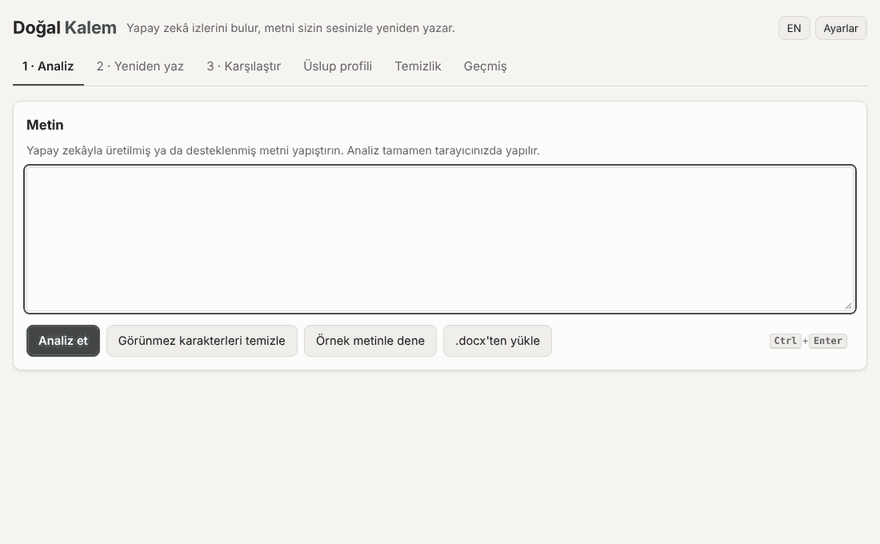
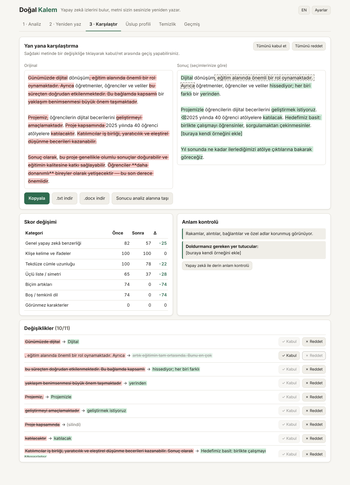
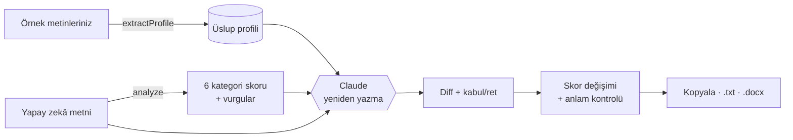

<div align="center">


# Doğal Kalem

**Yapay zekâ izlerini bulur, metni sizin sesinizle yeniden yazar.**

Türkçe ve İngilizce metinleri anlamı bozmadan, gerçek bir insanın, özellikle *sizin* yazdığınız gibi okunur hâle getiren tek dosyalık web uygulaması.

[](https://github.com/ozgeozdemirkuvvet/humanizer/actions/workflows/ci.yml)


[**Canlı demo**](https://ozgeozdemirkuvvet.github.io/humanizer/) · [Özellikler](#özellikler) · [Teknik öne çıkanlar](#teknik-öne-çıkanlar) · [Mimari](ARCHITECTURE.md) · [English](#english)



</div>

---

## Özellikler

| | |
|---|---|
| 🧬 **Kişisel üslup profili** | Kendi yazdığınız 3–5 metinden cümle uzunluğu ve ritmini, bağlaçlarınızı, hitap biçiminizi, resmiyet düzeyinizi, noktalama alışkanlıklarınızı, sevdiğiniz ve hiç kullanmadığınız ifadeleri ölçer. |
| 🔍 **Yapay zekâ izi analizi** | Altı kategoride 0–100 puan verir, bulguları metin üzerinde renkli vurgular ve her vurgu için doğal bir karşılık önerir. Çevrimdışı çalışır, yazdıkça güncellenir. |
| ✍️ **Yeniden yazma motoru** | Claude ile, ölçülen profilinize göre yazar. 5 ton (Resmî/MEB, Akademik, Erasmus+/eTwinning, Samimi e-posta, Öğrenci) ve 3 yoğunluk seçeneği vardır. Bilgi uydurmaz; eksik ayrıntı için `[buraya kendi örneğini ekle]` gibi yer tutucu bırakır. |
| ⚖️ **Karşılaştırma ve kontrol** | Kelime düzeyinde diff gösterir. Her değişikliği tek tek kabul ya da reddedebilirsiniz. Skorun önce/sonra değişimini ve iki katmanlı anlam kontrolünü (kaybolan ya da uydurulan sayı, alıntı, ad, kaynak) gösterir. |
| 🧹 **Temizlik araçları** | Görünmez karakterleri ve markdown artıklarını tek tıkla temizler. `.docx` dosyalarından yazar, şirket, uygulama, rsid, yorum yazarı ve izlenen değişiklik geçmişini siler. |
| 📱 **Her yerde çalışır** | Mobil uyumludur; açık/koyu tema ve TR/EN arayüz sunar. Uygulama olarak yüklenebilir ve çevrimdışı çalışır. Klavye kısayolları vardır; son 10 metni geçmişte tutar. |

<table>
  <tr>
    <td width="62%"></td>
    <td></td>
  </tr>
  <tr>
    <td></td>
    <td></td>
  </tr>
</table>

## Hızlı başlangıç

**Kurulum gerekmez.** [Canlı demoyu](https://ozgeozdemirkuvvet.github.io/humanizer/) açıp **Örnek metinle dene** düğmesine basın ya da `index.html` dosyasını indirip tarayıcıda çift tıklayın.

1. **Üslup profili** sekmesine kendi yazdığınız 3–5 metni yapıştırıp *Profili çıkar ve kaydet* düğmesine basın.
2. **Analiz** sekmesine metni yapıştırıp <kbd>Ctrl</kbd>+<kbd>Enter</kbd>'a basın.
3. **Ayarlar**'a [Anthropic API anahtarınızı](https://console.anthropic.com/) girin, ton ve yoğunluğu seçip <kbd>Ctrl</kbd>+<kbd>Shift</kbd>+<kbd>Enter</kbd>'a basın.
4. **Karşılaştır** sekmesinde değişiklikleri gözden geçirin, sonra kopyalayın ya da `.docx` olarak indirin.

| Kısayol | İşlev |
|---|---|
| <kbd>Ctrl</kbd>/<kbd>⌘</kbd> + <kbd>Enter</kbd> | Analiz et |
| <kbd>Ctrl</kbd>/<kbd>⌘</kbd> + <kbd>Shift</kbd> + <kbd>Enter</kbd> | Yeniden yaz |
| <kbd>Esc</kbd> | Yeniden yazmayı durdur |
| <kbd>←</kbd> <kbd>→</kbd> <kbd>Home</kbd> <kbd>End</kbd> | Sekmeler arasında gezin |

## Teknik öne çıkanlar

- **Sıfır derleme, tek dosya:** Yaklaşık 1650 satır, gzip ile 41 KB. Framework yok. İki kütüphane (Anthropic SDK, JSZip) sabit sürümle ve yalnızca gerektiği anda yükleniyor.
- **Türkçe'yi gerçekten anlayan eşleştirme:** `İ/ı` büyük/küçük harf sorununu (`AYRICA` → `ayrica` hatası) karakter sınıflarıyla çözüyor ve çekim eklerini (`kapsamlı~` → *kapsamlıdır*) yakalıyor. Unicode farkındalıklı kelime sınırları kullanıyor.
- **Açıklanabilir, deterministik analiz:** Her bulgu konumlu bir aralık ve bir öneriyle geliyor. 20.000 kelime yaklaşık 110 ms'de analiz ediliyor, tarama çizgisi algoritmasıyla 0,26 saniyede çiziliyor.
- **Ölçülen üslup, ölçülebilir hedef:** Profil modele "samimi yaz" gibi sıfatlarla değil, sayılarla aktarılıyor: cümle uzunluğu ortalaması ve değişim katsayısı, 100 kelimedeki noktalama sıklığı, bağlaç dağılımı.
- **Anlamı korumanın üç katmanı:** İstem kuralları, yerel olgu karşılaştırması (sayı, alıntı, URL, kaynak, özel ad; Türkçe ekler ayrıştırılarak) ve isteğe bağlı model denetimi.
- **Sağlam API entegrasyonu:** Resmî SDK ile akış (streaming), iptal, sunucu tarafı yedek model, `refusal` ve `max_tokens` durumlarının ele alınması, her HTTP hata sınıfı için anlaşılır mesaj.
- **Kalite güvencesi:**
  - Gerçek Chromium'da 17 uçtan uca test; API ve CDN taklit edildiği için ağ gerekmiyor.
  - Açık ve koyu temada, tüm ekranlarda axe-core ile **sıfır WCAG 2.1 AA ihlali**.
  - Performans eşikleri test kapsamında; ESLint ve CI her push'ta çalışıyor.
- **Gizlilik tasarımdan:** Sunucu yok. `.docx` işlemleri tarayıcıda yapılıyor. Service worker API trafiğine asla dokunmuyor.

Ayrıntılar ve tasarım kararları için: [ARCHITECTURE.md](ARCHITECTURE.md)

## Nasıl çalışır



| Kategori | Neye bakar | Ağırlık |
|---|---|---|
| Klişe kelime ve ifadeler | *Ayrıca, Sonuç olarak, önemli bir rol oynamaktadır, günümüzde, bu bağlamda…* / *delve, tapestry, crucial, pivotal, furthermore, seamless, robust…* | %25 |
| Tekdüze cümle uzunluğu | Cümle uzunluklarının değişim katsayısı (düşük "burstiness"), eşit uzunlukta paragraflar, aynı kelimeyle başlayan cümleler | %20 |
| Üçlü liste ve simetri | "X, Y ve Z" kalıpları, *hem… hem de*, *not only… but also* | %15 |
| Biçim artıkları | Uzun tire (—), `**kalın**`, `#` başlık, madde işaretleri, kod biçimi | %10 |
| Boş ve temkinli dil | *olabilir, genellikle, might, typically*; genel sonuç paragrafı; somut ayrıntı eksikliği | %20 |
| Görünmez karakterler | U+200B/C/D, U+FEFF, U+2060, yumuşak tire, bölünemez boşluk, karışık tırnak ve kesme işaretleri | %10 |

> [!NOTE]
> Puanlar sezgiseldir (heuristik). Bu bir "yapay zekâ dedektörü" sonucu değil, metni daha doğal kılmak için yol gösteren bir kontrol listesidir.

## Gizlilik

- Profil, örnek metinler, geçmiş ve API anahtarı yalnızca tarayıcınızın `localStorage` alanında tutulur.
- Metin yalnızca **Yeniden yaz** ya da **Yapay zekâ ile derin anlam kontrolü** düğmesine basıldığında doğrudan `api.anthropic.com` adresine gönderilir.

> [!WARNING]
> API anahtarı tarayıcıda saklandığı için uygulamayı ortak bilgisayarlarda kullanmayın. Ayrıntılar: [SECURITY.md](SECURITY.md)

## Geliştirme

```bash
npm install
npx playwright install chromium   # ilk seferde
npm run check                     # ESLint + 17 uçtan uca test (erişilebilirlik dâhil)
npm start                         # http://localhost:8080
```

```
index.html               Uygulamanın tamamı (HTML + CSS + JS, bölüm bölüm açıklamalı)
sw.js · manifest.webmanifest · icon.svg   PWA
tests/
  app.test.cjs           İşlev testleri: analiz, profil, diff, API, .docx
  quality.test.cjs       Erişilebilirlik (axe), performans, klavye, PWA
  helpers.cjs            Tarayıcı, CDN ve SSE API taklitleri
ARCHITECTURE.md          Tasarım kararları
.github/                 CI, GitHub Pages, Dependabot, issue/PR şablonları
```

Katkı vermek için: [CONTRIBUTING.md](CONTRIBUTING.md) · Sürüm notları: [CHANGELOG.md](CHANGELOG.md)

---

## English

**Doğal Kalem** ("Natural Pen") is a zero-build, single-file web app that detects AI-writing fingerprints in Turkish and English text and rewrites it, without changing its meaning, so it reads like *you* wrote it.

- **Measured style profile:** built from 3–5 of your own texts (sentence-length mean and variation, connectors, formality, punctuation rates, favourite and never-used phrases).
- **Explainable analysis:** six scored categories with positioned highlights, fully offline. Turkish-aware matching handles dotted/dotless i and suffixes.
- **Rewrite with Claude:** official SDK, streaming, server-side fallback, 5 tones × 3 intensities. Never invents facts; leaves placeholders instead.
- **Review:** word-level diff with per-change accept/reject, before/after scores and a three-layer meaning check.
- **Clean-up:** invisible characters, markdown leftovers, `.docx` metadata and tracked-change history.
- **Quality:** 17 end-to-end tests in Chromium, zero WCAG 2.1 AA violations (axe-core), lint and CI, installable PWA.

Try the [live demo](https://ozgeozdemirkuvvet.github.io/humanizer/). The UI switches between Turkish and English with one click.
