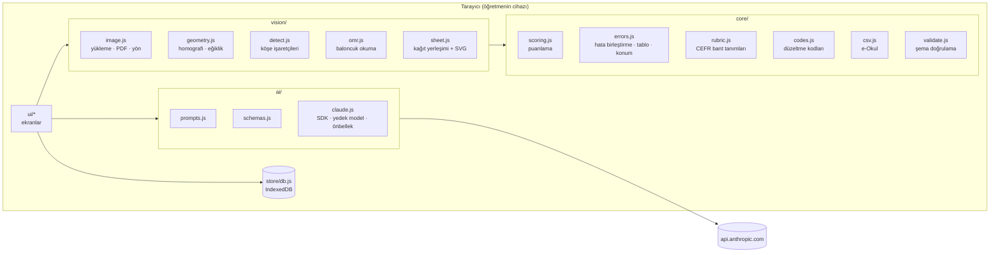
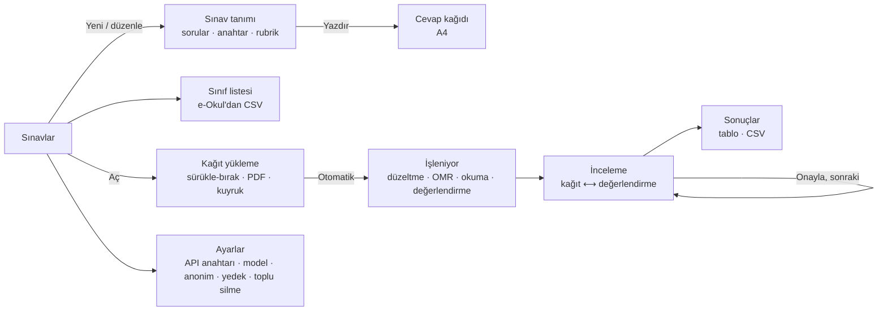

# Kırmızı Kalem: Mimari, veri yapısı ve ekran akışı

Kırmızı Kalem, İngilizce sınav kağıtlarını deneyimli bir öğretmenin titizliğiyle okuyan, puanlayan ve hataları kağıdın üzerinde gösterip açıklayan bir web uygulamasıdır. Bu belge uygulamanın nasıl kurulduğunu ve neden böyle kurulduğunu anlatır.

## 1. Temel kararlar

| Karar | Seçim | Gerekçe |
|---|---|---|
| Konum | `sinav/` klasörü, derleme adımı yok, yerel ES modülleri + Web Worker | GitHub Pages'ten (ya da `npm start` ile) açılır. Modüller `file://` üzerinden yüklenemediği için çift tıklayarak açılmaz. Saf modüller Node'da doğrudan test edilir. |
| Depolama | IndexedDB, yalnızca öğretmenin tarayıcısında | KVKK: sunucu yok, üçüncü taraf yok. Şifreli yedek alınabilir, dönem sonunda toplu silinebilir. |
| Kapalı uçlu sorular | **Cihazda optik okuma (OMR)** | Deterministik. Ağ gerekmez, görüntü dışarı çıkmaz. %98 uyum hedefi yapay zekâya bağlı kalmaz. |
| El yazısı ve writing | Claude (öğretmenin kendi API anahtarıyla), iki aşamada | Aşama A görüntüyü okur ve metne çevirir. Aşama B yalnızca metni değerlendirir. Okuma ile puanlama ayrıldığı için öğretmen okumayı düzeltebilir. Aynı metin her zaman aynı sonucu alır (önbellek). |
| Kişisel veri | Ad ve numara bölgesi **hiç gönderilmez** | Bizim kağıdımızda yalnızca cevap kutuları kırpılıp gönderilir. Numara cihazda baloncuklardan okunur, ad sınıf listesinden eşlenir. Serbest kağıtta üst bant karartılır. |
| Puanın gerekçesi | Şema zorunlu kılar | Gerekçesi boş olan rubrik puanı ya da açıklaması eksik hata, doğrulayıcıdan geçmez ve "Öğretmen kontrolü gerekli" olarak işaretlenir. |
| Kesinleşme | Hiçbir not öğretmen onayı olmadan dışa aktarılmaz | Durum makinesi: `yuklendi → okundu → degerlendirildi → onaylandi` |

## 2. Bileşenler



## 3. Bir kağıdın yolculuğu

1. **Yükleme:** JPG, PNG, HEIC (tarayıcı destekliyorsa) ya da PDF. PDF'nin her sayfası pdf.js ile 150 dpi'ye çizilir. EXIF yönü uygulanır.
2. **Düzeltme ve kırpma:**
   - *Kırmızı Kalem kağıdı:* Dört köşe işaretçisi bulunur, homografi ile kağıt kanonik A4 tuvaline (1240×1754) düzleştirilir. Üstteki yön çubuğuyla 90°, 180° ve 270° dönüklük de düzeltilir. Alttaki 8 bitlik şerit sayfa numarasını ve sınav parmak izini taşır. Yanlış sınavın kağıdı uyarı verir.
   - *Serbest kağıt:* Kağıt arka plandan ayrılıp kırpılır. İzdüşüm profiliyle ±8° eğiklik düzeltilir. Üst bant (öntanımlı %15) karartılır.
3. **Kimlik:** Numara baloncuklardan okunur ve sınıf listesindeki adla eşlenir. Öğretmen onaylar. Eşleşme yoksa elle seçilir.
4. **Optik okuma:** Her baloncuğun iç bölgesinin koyuluğu ölçülür. Dört sonuç çıkar: işaretli, boş, birden fazla işaret ya da belirsiz. Her birinin güven skoru vardır.
5. **Aşama A, okuma (Claude, görsel):** Yalnızca kısa cevap kutuları ve writing alanı kırpılarak gönderilir. Model satır satır, kelime kelime metin, güven skoru ve kelime kutusu döndürür. Güveni 0,5'in altında olan kelime **yerelde de** `[okunamadı]` yapılır. Model "tahmin etti" diye bu kelime geçmez.
6. **Puanlama (yerelde):** Kapalı uçlu sorular anahtarla birebir karşılaştırılır. Boşluk doldurma için normalleştirme ve alternatifler kullanılır, katı ya da esnek yazım toleransı uygulanır (Damerau-Levenshtein).
7. **Aşama B, değerlendirme (Claude, yalnızca metin):** Writing rubrik bantları ve gerekçeleri, hatalar (satır + alıntı), kural açıklamaları (her kural bir kez), öneriler, yanlış kapalı uçlu cevapların açıklamaları ve geri bildirim üretilir. Hatanın **karakter konumu yerelde hesaplanır**: alıntı satırda aranır. Bulunamazsa hata "Öğretmen kontrolü gerekli" olur, uydurma konum çizilmez.
8. **İnceleme:** Kağıt ve değerlendirme yan yana durur, hatalar kağıdın üzerinde numaralı etiketlerle görünür. Öğretmen her şeyi düzenleyebilir. Her düzenleme `edits` günlüğüne yazılır ve aynı sınavın sonraki değerlendirmelerine "öğretmen tercihleri" olarak eklenir.
9. **Onay ve dışa aktarma:** e-Okul CSV dosyası üretilir (UTF-8 BOM, `;` ayraç, Türkçe Excel uyumlu).

## 4. Veri yapısı (JSON şemaları)

Tüm kimlikler `crypto.randomUUID()` ile üretilir. Koordinatlar kanonik sayfa pikselidir (1240×1754). Serbest kağıtta koordinatlar kırpılmış görüntüye göredir.

### 4.1 Sınav (`exams`)

```json
{
  "id": "uuid",
  "name": "9. Sınıf 1. Dönem 1. Yazılı",
  "grade": "9",                       // "hazirlik" | "9" | "10" | "11" | "12"
  "className": "9-A",
  "cefr": "A2",                       // A1 | A2 | B1 | B2
  "explainLang": "tr",                // açıklama ve geri bildirim dili: "tr" | "en"
  "langWeight": 0,                    // açık uçlu sorularda dil doğruluğunun payı (%); okuma sorularında genelde 0
  "readingText": "…",                 // isteğe bağlı okuma metni (yalnızca değerlendirmede kullanılır)
  "markingNotes": "…",                // öğretmenin puanlama notları (istemde varsayılanların önüne geçer)
  "spelling": "esnek",                // "katı" | "esnek"
  "sheetMode": "kirmizikalem",        // "kirmizikalem" | "serbest"
  "redactTop": 0.15,                  // serbest kağıtta karartılacak üst bant oranı
  "questions": [
    { "id": "q1", "no": 1, "type": "mc", "points": 4, "options": 4,
      "key": ["B"], "text": "She ___ to school yesterday.", "outcome": "E9.1.G1", "note": "" },
    { "id": "q2", "no": 2, "type": "tf", "points": 2, "key": ["D"] },
    { "id": "q3", "no": 3, "type": "match", "points": 2, "options": 5, "key": ["C"] },
    { "id": "q4", "no": 4, "type": "gap", "points": 4, "prefix": "w",   // kağıtta verilen ilk harf(ler)
      "key": ["went"], "alternatives": ["had gone"], "text": "Yesterday I ___ (go) to the cinema." },
    { "id": "q6", "no": 6, "type": "open", "points": 10, "lines": 3,
      "text": "Why did Tom go to London? Answer according to the text.",
      "modelAnswer": "He went to London to visit his grandmother.",
      "keyPoints": ["Londra'ya gitti", "büyükannesini ziyaret etmek için"] },   // boşsa örnek cevabın anlamı tek nokta
    { "id": "q5", "no": 5, "type": "writing", "points": 30,
      "text": "Write an e-mail to a friend about your last holiday (80–100 words).",
      "minWords": 80, "maxWords": 100, "lines": 18,
      "rubric": { "TA": 1, "CC": 1, "LR": 1, "GRA": 1 } }   // ölçüt ağırlıkları
  ],
  "createdAt": "ISO-8601", "updatedAt": "ISO-8601"
}
```

### 4.2 Kağıt (`papers`)

```json
{
  "id": "uuid",
  "examId": "uuid",
  "status": "degerlendirildi",        // yuklendi | okunuyor | okundu | degerlendiriliyor | degerlendirildi | onaylandi | hata
  "student": { "no": "1234", "name": "Ayşe Yılmaz", "confirmed": true, "pseudonym": "Öğrenci 07" },
  "pages": [
    { "imageId": "uuid", "index": 1, "mode": "kirmizikalem",
      "width": 1240, "height": 1754,
      "detect": { "ok": true, "rotation": 0, "examMatch": true, "skewDeg": 0 } }
  ],
  "reading": {                        // Aşama A çıktısı + optik okuma
    "omr": [ { "questionId": "q1", "value": "B", "state": "isaretli", "confidence": 0.97 } ],
    "regions": [
      { "regionId": "q5", "questionId": "q5", "page": 1,
        "rect": { "x": 90, "y": 900, "w": 1060, "h": 740 },
        "lines": [
          { "n": 1, "words": [
            { "text": "She", "confidence": 0.98, "box": [12, 8, 80, 44] },
            { "text": "[okunamadı]", "confidence": 0.31, "box": [90, 8, 170, 44], "illegible": true }
          ] } ] } ]
  },
  "scores": [
    { "questionId": "q1", "earned": 0, "max": 4, "auto": true,
      "reason": "İşaretlenen: C · Anahtar: B", "needsReview": false },
    { "questionId": "q5", "earned": 22.5, "max": 30, "auto": true,
      "rubric": [
        { "criterion": "TA",  "band": 4, "justification": "Tatilin yeri, zamanı ve etkinlikleri anlatılmış; kapanış eksik." },
        { "criterion": "CC",  "band": 3, "justification": "..." },
        { "criterion": "LR",  "band": 3, "justification": "..." },
        { "criterion": "GRA", "band": 2, "justification": "..." } ],
      "reason": "Rubrik: TA 4 · CC 3 · LR 3 · GRA 2 (ağırlıklı ortalama 3/5)" }
  ],
  "errors": [ /* 4.3 */ ],
  "rules":  [ /* 4.4 */ ],
  "suggestions": [ /* 4.5 */ ],
  "feedback": {
    "lang": "tr",
    "strength": "Tatil anlatında olayları sırasıyla ve canlı ayrıntılarla vermişsin.",
    "improvements": [ "Geçmiş zaman (V2) çekimleri", "'the' kullanımı", "Paragraf geçiş ifadeleri" ],
    "studyTip": "Düzensiz fiiller listesinden her gün 10 fiili cümle içinde yaz."
  },
  "total": { "earned": 68.5, "max": 100, "grade100": 69 },
  "approvedAt": null,
  "model": "claude-opus-5-5",
  "createdAt": "ISO-8601", "updatedAt": "ISO-8601"
}
```

### 4.3 Hata (`paper.errors[]`)

```json
{
  "id": "e7",
  "no": 7,                              // kağıt üzerindeki numaralı etiket
  "questionId": "q5",
  "line": 2,                            // writing satır numarası (kapalı uçlu sorularda null)
  "quote": "go",                        // öğrencinin yazdığı hatalı kelime/ifade (birebir)
  "occurrence": 1,                      // satırda aynı alıntı birden fazla geçiyorsa kaçıncısı
  "span": { "start": 4, "end": 6 },     // satır metnindeki karakter aralığı (yerelde hesaplanır)
  "box": { "x": 212, "y": 958, "w": 40, "h": 30 },  // sayfa üzerindeki işaret (kanonik px)
  "code": "T",                          // Gr Sp WW WO T Agr Art Prep P ^ Key
  "ruleId": "past-simple-yesterday",    // aynı kuraldan gelen tekrarlar bu alanla gruplanır
  "original": "She go to school yesterday.",
  "corrected": "She went to school yesterday.",
  "correction": "went",
  "severity": "bozmuyor",               // "bozuyor" (kırmızı) | "bozmuyor" (turuncu)
  "certain": true,                      // false → gri, "Öğretmen kontrolü gerekli"
  "uncertainReason": "",
  "impact": { "kind": "rubric", "criterion": "GRA" },  // ya da { "kind": "points", "points": -4 }
  "source": "ai",                       // ai | yerel | ogretmen
  "teacherEdited": false
}
```

### 4.4 Kural açıklaması (`paper.rules[]`): her kural **bir kez** açıklanır

```json
{
  "ruleId": "past-simple-yesterday",
  "code": "T",
  "explanation": "'yesterday' geçmiş zamanı gösterir; bu yüzden fiil 2. hâline (went) geçmelidir.",
  "example": "We visited our grandparents yesterday."
}
```

Tekrar özeti `errors.js` içinde türetilir: `Bu hata kağıtta 4 kez geçiyor (Satır 2, 5, 7, 9)`.

### 4.5 Öneri (`paper.suggestions[]`): puan kırmaz, mavi

```json
{ "id": "s1", "questionId": "q5", "line": 4, "quote": "very good",
  "suggestion": "amazing", "reason": "Daha zengin bir sıfat, B1 hedefi için uygun.", "box": {...} }
```

### 4.6 Öğretmen düzenlemesi (`edits`)

```json
{ "id": "uuid", "examId": "uuid", "paperId": "uuid", "at": "ISO-8601",
  "kind": "error.delete",              // error.delete | error.edit | error.add | score.edit | band.edit | feedback.edit | reading.edit
  "before": { "code": "Art", "quote": "the", "ruleId": "article-unique" },
  "after": null,
  "note": "Bu kullanım bu seviyede kabul." }
```

Aşama B istemine aynı sınavın son 30 düzenlemesi kısa kurallar hâlinde eklenir. Örnek: "Öğretmen 'Art: the' (article-unique) hatasını silmişti, bu seviyede işaretleme."

## 5. Puanlama kuralları

| Soru tipi | Kural |
|---|---|
| `mc`, `tf`, `match` | Anahtarla birebir eşleşme gerekir. Boş cevap 0 puan alır. Birden fazla işaret 0 puan alır ve "Öğretmen kontrolü gerekli" olur. Belirsiz baloncukta da öğretmen kontrolü istenir. |
| `gap` | Metin normalleştirilir: küçük harf, boşluklar tekleştirilir, akıllı tırnaklar düzeltilir, sondaki nokta atılır. Ardından anahtar ve alternatiflerle karşılaştırılır. *Katı* modda tam eşleşme aranır. *Esnek* modda uzunluk 4–7 karakterse 1, 8 ve üzeriyse 2 harflik yazım farkı kabul edilir. Tam puan verilir, ama turuncu bir **Sp** hatası 0 puan etkisiyle eklenir. Okuma güveni düşükse öğretmen kontrolü istenir. |
| `open` | Her içerik noktası `karsilandi` (1) / `kismen` (0,5) / `eksik` (0) olarak, gerekçesiyle değerlendirilir. Puan = soru puanı × [(1 − dil payı) × ortalama nokta oranı + dil payı × dil bandı/4], 0,5'e yuvarlanır. İçerik oranı 0 ise dil puanı verilmez. Dil hataları `impact: {kind: "language"}`, yanlış bilgi `Key` koduyla `impact: {kind: "content"}` taşır. Skor kaydında `open: {points[], language{band, justification}, langWeight}` tutulur. |
| `writing` | 4 ölçüt (TA, CC, LR, GRA) 0–5 bant üzerinden puanlanır. Puan = soru puanı × Σ(ağırlık × bant/5) / Σ ağırlık, 0,5'e yuvarlanır. Bant tanımları CEFR seviyesine göre kalibre edilmiştir. Kelime sayısı yerelde hesaplanır ve TA gerekçesine eklenir. |
| Toplam | Sınavın toplam puanı 100 değilse 100'e ölçeklenir. e-Okul notu yarım yukarı yuvarlanır. |

## 6. Ekran akışı



**İnceleme ekranı.** Geniş ekranda iki sütun vardır: solda kağıt görüntüsü ve SVG katmanı, sağda sekmeler (Puan, Hatalar, Hata tablosu, Geri bildirim, Okuma). Telefonda tek sütun olur ve "Kağıt / Değerlendirme" geçiş düğmesiyle değiştirilir. İşaret renkleri şöyledir: **kırmızı** anlamı bozan hata, **turuncu** anlamı bozmayan hata, **mavi** öneri, **gri** öğretmen kontrolü gerekli. Etikete dokunulunca açıklama kartı açılır. Kısayollar: `J`/`K` önceki ve sonraki kağıt, `A` onayla ve sonrakine geç, `1–9` hata kartına git.

## 7. Kabul kriterleri ve nasıl ölçüldükleri

| Kriter | Ölçüm |
|---|---|
| Kapalı uçlu sorularda ≥%98 uyum | `sinav/tests/omr.test.mjs`: 30 sentetik fotoğraf (dönme, 90°/180° çevrik, perspektif, gölge, gürültü; koyu/soluk/küçük/çarpı/silinmiş/çift işaret). **Sonuç: %100 (1200/1200), %2,1'i öğretmen kontrolüne işaretlendi.** Gerçek kağıtlarla saha doğrulaması öğretmen tarafından yapılmalıdır. |
| Writing'de ±1 bant | Kodla garanti edilemez. İstem, CEFR'e kalibre bant tanımları ve öğretmen düzenleme günlüğüyle desteklenir. Doğrulama için 3–5 gerçek kağıt gerekir (Sürüm 2'deki kalibrasyon ekranı). |
| Her hata eksiksiz | `validate.js` her hatada konum, tür, doğru biçim ve açıklama ister. Eksik olan hata gri işaretlenir. Testte zorunlu tutulur. |
| 30 kağıt 10 dakikanın altında | Yerel işlem kağıt başına ~0,12 sn. API çağrıları eşzamanlı 6 iş kuyruğunda yürür. Uçtan uca test, çağrı başına 1,5 sn taklit gecikmeyle 30 kağıdı **18 sn**'de işledi. Gerçek API ile tahmin: 4–8 dk. |

## 8. Güvenlik ve gizlilik

- Ağ trafiği yalnızca `api.anthropic.com` adresine gider ve yalnızca cevap bölgelerini içerir. Ad ve numara hiçbir istekte yer almaz. Model öğrenciyi yalnızca `paperId` ile tanır.
- Anonim modda arayüzde ve dışa aktarılan geri bildirimlerde takma ad görünür. e-Okul CSV'si her zaman gerçek numarayı kullanır.
- Toplu silme sınavları, kağıtları, görüntüleri, düzenleme günlüğünü ve önbelleği tek işlemle siler.
- Yedek, parolayla AES-GCM (PBKDF2, 250.000 tur) şifrelenmiş tek bir dosyadır.
- Model metni ve öğrenci metni her zaman `textContent` ya da `esc()` ile yazılır, asla ham `innerHTML` ile yazılmaz.

## 9. Sürüm 2'ye kalanlar

Sınıf raporları, kalibrasyon ekranı (3–5 örnek kağıt), kazanım analizi, PDF geri bildirim kağıtları ve Excel (.xlsx) çıktısı. Veri yapısı bunlara şimdiden hazırdır: `outcome` alanı, `edits` günlüğü ve `rubric` gerekçeleri.
