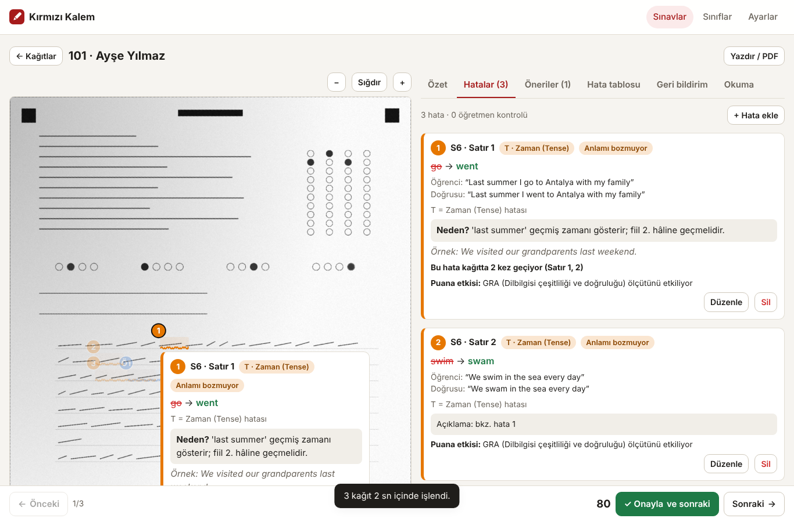
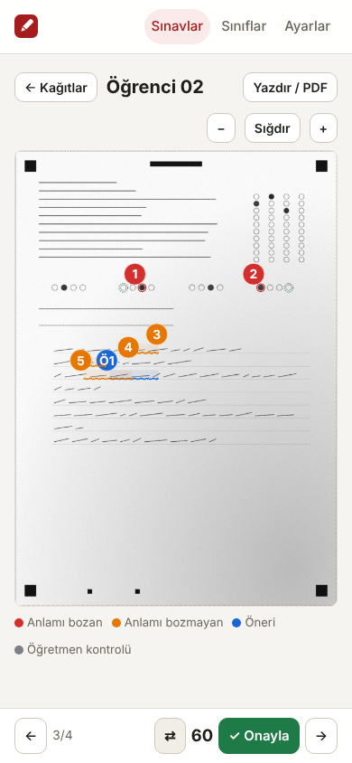
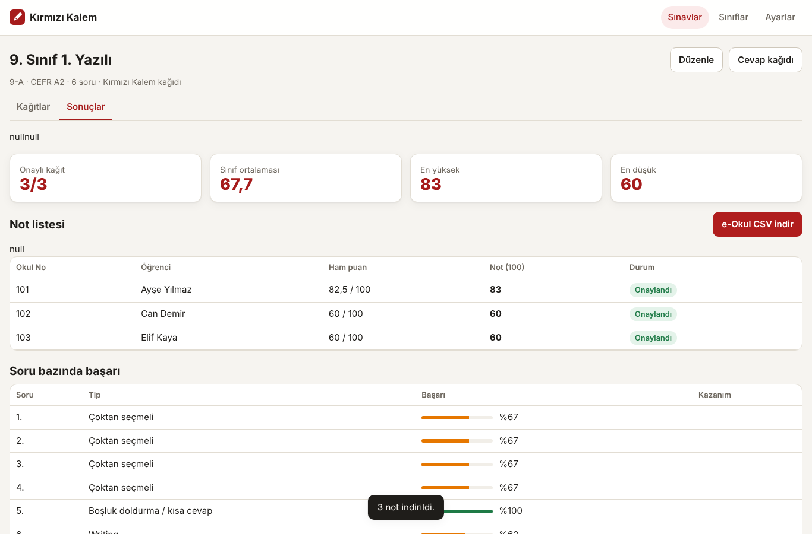

# Kırmızı Kalem

**İngilizce sınav kağıtlarını deneyimli bir öğretmenin titizliğiyle okur, puanlar ve her hatayı kağıdın üzerinde gösterip açıklar.**

Hazırlık, 9 ve 11. sınıflar ile CEFR A1–B2 seviyeleri için tasarlandı. Notlar 100 üzerinden hesaplanır ve e-Okul'a girilecek CSV olarak indirilir. **Hiçbir not öğretmen onaylamadan kesinleşmez.**



## Ne yapar?

| Adım | Ne olur? |
|---|---|
| **1. Sınav tanımı** | Sınav adı, sınıf, hedef CEFR seviyesi ve sorular girilir: çoktan seçmeli, doğru/yanlış, eşleştirme, boşluk doldurma ve writing. Her soru için puan, cevap anahtarı, kabul edilen alternatifler ve rubrik ağırlıkları belirlenir. Kazanım eşlemesi isteğe bağlıdır. |
| **2. Cevap kağıdı** | Uygulama A4 bir cevap kağıdı üretir. Kağıtta köşe işaretçileri, okul numarası tablosu, baloncuklar, kısa cevap kutuları ve satır numaralı writing alanı bulunur. Kendi kağıdınızı da kullanabilirsiniz (serbest mod). |
| **3. Yükleme** | Fotoğraflar ve taranmış PDF'ler toplu yüklenir. Sayfalar otomatik düzeltilir (perspektif, dönme, eğiklik) ve kırpılır. Okul numarası okunup sınıf listesindeki adla eşlenir; kimliği öğretmen onaylar. |
| **4. Okuma** | Baloncuklar **cihazda** okunur. El yazısı Claude ile kelime kelime okunur ve her kelimenin bir güven skoru olur. Okunamayan kelime tahmin edilmez, **[okunamadı]** olarak işaretlenir. |
| **5. Puanlama** | Kapalı uçlu sorular anahtarla birebir karşılaştırılır. Boşluk doldurmada alternatif cevaplar kabul edilir ve yazım toleransı katı ya da esnek seçilebilir. Writing dört ölçütle (TA, CC, LR, GRA) 0–5 bant üzerinden, hedef CEFR seviyesine kalibre edilerek puanlanır. Her puanın bir gerekçesi vardır. |
| **6. Hata analizi** | Her hata için şunlar verilir: konum (soru ve satır, kağıt üzerinde numaralı işaret), kod (Gr, Sp, WW, WO, T, Agr, Art, Prep, P, ^), yazılan ve doğru biçim, sade dille neden, benzer bir örnek, puana etkisi ve ciddiyet. Tekrarlayan hatalar tek tek işaretlenir ama bir kez açıklanır: "Bu hata kağıtta 4 kez geçiyor (Satır 2, 5, 7, 9)". |
| **7. Geri bildirim** | Her öğrenciye 1 güçlü yön, en fazla 3 gelişim alanı ve 1 somut çalışma önerisi yazılır. Dil Türkçe ya da İngilizce olabilir. |
| **8. Onay ve çıktı** | Öğretmen her puanı, bandı, hatayı ve okumayı düzenleyebilir. Düzenlemeler kaydedilir ve sonraki değerlendirmelerde dikkate alınır. Onaylı notlar e-Okul CSV dosyası olarak indirilir. |

**Renkler:** 🔴 anlamı bozan hata · 🟠 anlamı bozmayan hata · 🔵 öneri (puan kırmaz) · ⚪ gri: öğretmen kontrolü gerekli.

**Kısayollar (inceleme ekranı):** `J` önceki kağıt · `K` sonraki kağıt · `A` onayla ve sonrakine geç · `1–9` o numaralı hataya git.

<p>


</p>

## Hızlı başlangıç

1. Uygulamayı açın: **https://ozgeozdemirkuvvet.github.io/Humanizer/sinav/** ya da yerelde `npm start` çalıştırıp `http://localhost:8080/sinav/` adresine gidin.
2. **Ayarlar** bölümüne Anthropic API anahtarınızı girin. Anahtar olmadan da kapalı uçlu sorular puanlanır.
3. **Sınıflar** bölümüne e-Okul'dan aldığınız listeyi (`No;Ad Soyad`) yapıştırın.
4. **Yeni sınav** oluşturun, kaydedin, **Cevap kağıdı**nı yazdırın.
5. Doldurulan kağıtların fotoğraflarını ya da PDF'ini **Kağıtlar** ekranına sürükleyin.
6. **İncelemeye başla** düğmesine basın. Her kağıdı gözden geçirip `A` ile onaylayın.
7. **Sonuçlar** sekmesinden **e-Okul CSV indir** düğmesine basın.

> Uygulama ES modülleri ve Web Worker kullanır. Bu yüzden `index.html` dosyasına çift tıklayarak (`file://`) açılmaz; bir web adresinden açılmalıdır (GitHub Pages ya da `npm start`).

## Gizlilik (KVKK)

- **Sunucu yok.** Tüm veriler (sınavlar, kağıtlar, görüntüler, düzenlemeler) yalnızca öğretmenin tarayıcısında, IndexedDB'de saklanır.
- **Öğrenci adı ve numarası hiçbir yere gönderilmez.** Kırmızı Kalem kağıdında numara cihazda okunur ve yapay zekâya yalnızca cevap kutularının kırpıntısı gider. Serbest kağıtta sayfanın üst bandı gönderilmeden önce karartılır. Bu davranış testlerle doğrulanır.
- Ağ trafiği yalnızca `api.anthropic.com` adresine gider ve öğretmenin kendi API anahtarıyla yapılır.
- **Anonim mod:** Ekranda ve raporlarda "Öğrenci 07" gibi takma adlar görünür.
- **Şifreli yedek** (AES-GCM, parolayla) alınabilir. **Dönem sonu toplu silme** tek tuşla yapılır.

## Kabul kriterleri: ölçülen sonuçlar

| Kriter | Hedef | Ölçülen | Nasıl |
|---|---|---|---|
| Kapalı uçlu sorularda öğretmen puanıyla uyum | ≥ %98 | **%100** (1200/1200 cevap), %2,1'i öğretmen kontrolüne işaretlendi | `tests/omr.test.mjs`: 30 sentetik fotoğraf. Fotoğraflarda ±8° dönme, 90° ve 180° çevrik çekim, perspektif, gölge ve gürültü var. İşaretler koyu, soluk, küçük, çarpı, silinip yeniden işaretlenmiş, boş ve çift olarak üretildi. |
| Okul numarası ve sayfa kodu | — | 30/30 | aynı test |
| Her hatada konum, tür, doğru biçim ve açıklama | eksiksiz | doğrulayıcı zorunlu tutuyor; eksik olan hata gri işaretleniyor | `tests/core.test.mjs`, `tests/ai.test.mjs` |
| 30 kağıt 10 dakikanın altında | < 10 dk | yerel işlem kağıt başına ~0,12 sn. Taklit API ile (çağrı başına 1,5 sn) 30 kağıt **18 sn** sürdü. | `tests/e2e.test.mjs` |
| Writing'de en fazla ±1 bant sapma | ±1 bant | **henüz ölçülmedi** | Gerçek kağıt ve gerçek API gerekiyor (aşağıya bakın) |

**Dürüst notlar:**

- Optik okuma sonuçları **sentetik** fotoğraflarla elde edildi. Gerçek sınıfta ilk kullanımda 2–3 kağıdı elle karşılaştırmanız önerilir.
- Gerçek API ile kağıt başına iki çağrı yapılır: okuma ve değerlendirme. Opus 5.5 ile bir çağrı tipik olarak 20–60 saniye sürer. Eşzamanlı 6 işle 30 kağıt yaklaşık **4–8 dakika** sürer; bu bir tahmindir. Ayarlardan Sonnet 5.5'e geçmek süreyi kısaltır.
- Writing bant uyumu (±1) ancak **sizin puanladığınız 3–5 gerçek kağıtla** ölçülebilir. Kalibrasyon ekranı Sürüm 2'de. O zamana kadar her bant düzenlemeniz "öğretmen tercihi" olarak sonraki değerlendirmelere eklenir.

## Geliştirme

```bash
npm ci
npm run test:sinav   # birim + optik okuma + yapay zekâ katmanı + uçtan uca (Chromium)
npm run lint
npm start            # http://localhost:8080/sinav/
SHOTS=./ekranlar node --test sinav/tests/e2e.test.mjs   # ekran görüntüleriyle
```

| Klasör | İçerik |
|---|---|
| `js/core/` | Saf mantık: puanlama, rubrik, hata konumlandırma ve tablo, CSV, sınav doğrulama, birleştirme |
| `js/vision/` | Saf görüntü işleme: kağıt yerleşimi ve SVG, homografi, köşe tespiti, optik okuma, serbest kağıt düzeltme |
| `js/ai/` | Claude: istemler, yapılandırılmış çıktı şemaları, önbellekli çağrılar |
| `js/store/` | IndexedDB, şifreli yedek |
| `js/browser/` | Dosya → piksel (pdf.js dahil), JPEG kodlama |
| `js/ui/` | Ekranlar: çalışma alanı ve inceleme |
| `tests/` | Node testleri ve Playwright uçtan uca testleri; sentetik fotoğraf üretici |

Mimari, veri şemaları (kağıt, hata, kural, düzenleme) ve ekran akışı için: [MIMARI.md](MIMARI.md).

## Sürüm 2

Sınıf raporları (hata türü sıklığı ve tipik örnekler, kazanım analizi, tekrar edilecek konular), kalibrasyon ekranı, PDF geri bildirim kağıtları ve Excel (.xlsx) çıktısı. MVP'de bunların temeli hazırdır: soru bazında başarı tablosu, düzenleme günlüğü ve öğrenci raporu yazdırma.
